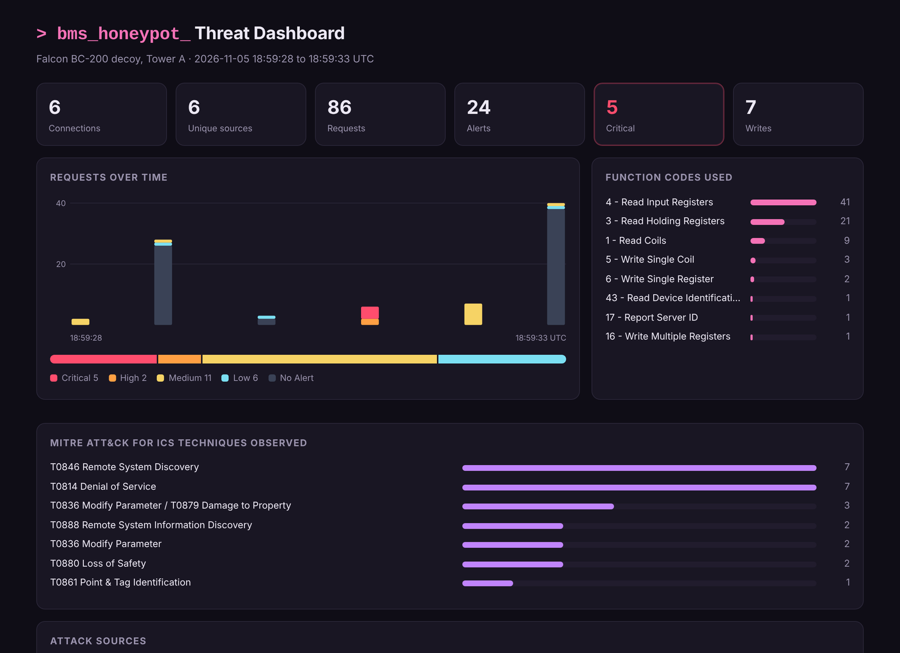
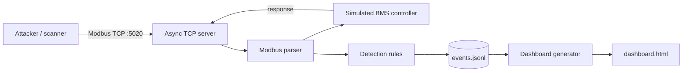
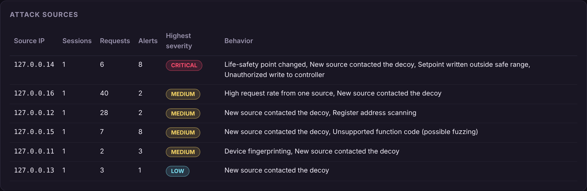
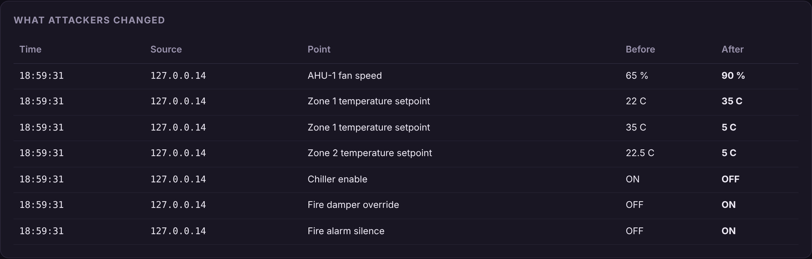

# BMS Modbus Honeypot

A decoy **Building Management System (BMS) controller** that speaks Modbus TCP, records every interaction, and classifies attacker behavior using **MITRE ATT&CK for ICS**. It includes an attack simulator and a threat dashboard.

Building systems such as HVAC, chillers, lighting, and fire dampers are often controlled over Modbus, a protocol with no authentication. Anyone who can reach the device can read or change it. This project shows what that looks like from the defender's side: a fake controller that looks real to an attacker and tells you exactly what they tried.



## Features

- **Realistic decoy device.** It emulates a building controller with temperature setpoints, live sensor readings that drift over time, equipment coils, and life-safety points. Writes really change the values, so an attacker sees their changes take effect.
- **Modbus TCP written from scratch.** The protocol is implemented with the Python standard library, so every byte on the wire can be logged, including malformed and unsupported requests.
- **Eight detection rules**, each mapped to MITRE ATT&CK for ICS (see below).
- **Structured JSON logging**, one event per line, ready to load into a SIEM.
- **Attack simulator** covering six attack stages, from reconnaissance to sabotage.
- **Threat dashboard**: a single self-contained HTML file with charts, attack sources, a change log, and alerts.
- **Zero dependencies** and 17 unit and integration tests.

## How It Works



1. The server accepts connections and splits the byte stream into Modbus frames.
2. The simulated controller answers each request the way a real device would, including standard Modbus exception responses.
3. The detector inspects each request against its rules, keeping per-source state for rate and scanning detection.
4. Every connection, request, and alert is written to a JSON Lines log, and the dashboard is built from that log.

## Detection Rules

| Rule | Severity | Triggers when | MITRE ATT&CK for ICS |
|---|---|---|---|
| New source contacted the decoy | Low | Any source sends its first request. A decoy has no legitimate users. | T0846 Remote System Discovery |
| Device fingerprinting | Medium | Read Device Identification (FC43) or Report Server ID (FC17) | T0888 Remote System Information Discovery |
| Register address scanning | Medium | Repeated requests to addresses that don't exist | T0861 Point & Tag Identification |
| High request rate | Medium | 30+ requests in 10 seconds from one source | T0846 Remote System Discovery |
| Unsupported function code | Medium | Function codes the controller doesn't use (possible fuzzing) | T0814 Denial of Service |
| Unauthorized write | High | Any write to a setpoint or coil | T0836 Modify Parameter |
| Unsafe setpoint | Critical | A write outside the point's safe range, e.g. a zone set to 35 °C | T0836 Modify Parameter / T0879 Damage to Property |
| Life-safety tampering | Critical | Changing the fire damper override or fire alarm silence | T0880 Loss of Safety |

Safe ranges and safety points are defined per point in [`config/device_profile.json`](config/device_profile.json), so the rules adapt to any device you emulate.

## Quick Start

Requires Python 3.9+. No packages to install.

```bash
git clone https://github.com/ZainabAlramadhan/bms-modbus-honeypot.git
cd bms-modbus-honeypot

# 1. Start the honeypot
python run_honeypot.py --port 5020

# 2. In a second terminal, run the attack simulator
python simulate_attacker.py --port 5020

# 3. Build the dashboard and open dashboard.html in a browser
python dashboard.py

# Run the tests
python -m unittest discover -s tests -t .
```

Port 5020 is used because the standard Modbus port, 502, needs administrator rights. Nmap's `modbus-discover` script only targets port 502, so to scan the honeypot the way an attacker would, run it on 502 in a lab VM:

```bash
sudo python3 run_honeypot.py --port 502
nmap -p 502 --script modbus-discover 127.0.0.1
```

## Demo: A Simulated Attack

The simulator runs six scenarios in order. In demo mode each one connects from a different loopback address, so the dashboard shows six distinct attackers.

| Scenario | What the attacker does | What the honeypot detected |
|---|---|---|
| `recon` | Asks the device for its vendor and firmware | Device fingerprinting |
| `scan` | Probes addresses to map which registers exist | Register address scanning |
| `read` | Reads sensors, setpoints, and equipment status | New source contacted the decoy |
| `tamper` | Changes setpoints, turns off the chiller, overrides the fire damper, silences the fire alarm | 5 critical and 2 high alerts |
| `fuzz` | Sends seven unsupported function codes | Unsupported function code (x7) |
| `flood` | Sends 40 rapid read requests | High request rate |

**Results from the included sample run** ([`sample-logs/events.jsonl`](sample-logs/events.jsonl)): 6 attackers, 86 requests, and 24 alerts, 5 of them critical. Every scenario was detected.



The change log shows exactly what the attacker did to the building:



[Full dashboard screenshot](docs/dashboard-full.png)

## Sample Log Event

```json
{
  "ts": "2026-11-05T18:59:31.484+00:00",
  "event": "request",
  "src_ip": "127.0.0.14",
  "function": 5,
  "function_name": "Write Single Coil",
  "address": 5,
  "writes": [{"name": "Fire alarm silence", "old_text": "OFF", "new_text": "ON", "safety": true}],
  "alerts": [{"rule": "SAFETY_SYSTEM_TAMPERING", "severity": "critical",
              "title": "Life-safety point changed", "attack": "T0880 Loss of Safety"}],
  "max_severity": "critical"
}
```

*Shortened for readability. Real events also include the session ID, source port, transaction ID, and raw request bytes.*

## Project Structure

```
bms-modbus-honeypot/
├── honeypot/
│   ├── modbus.py        # Modbus TCP framing, parsing, and request builders
│   ├── device.py        # Simulated BMS controller
│   ├── detector.py      # Detection rules mapped to ATT&CK for ICS
│   └── server.py        # Async TCP server and JSON event log
├── config/
│   └── device_profile.json   # Device identity, points, safe ranges
├── run_honeypot.py      # Start the honeypot
├── simulate_attacker.py # Attack scenarios (lab use only)
├── dashboard.py         # HTML dashboard generator
├── tests/               # Unit and integration tests
├── sample-logs/         # Log from the demo run
└── docs/                # Screenshots
```

## What I Learned

- **Modbus has no security built in.** There is no authentication or encryption, and any client can read or write any point. Securing it depends entirely on network segmentation and monitoring.
- **Writes are where the damage happens.** Reconnaissance is noisy but harmless. The critical moments are writes, especially to setpoints outside safe ranges and to life-safety points.
- **Decoys give high-confidence alerts.** A real controller sees constant legitimate polling, but a decoy has no legitimate users, so even a single read is worth investigating.
- **Mapping detections to ATT&CK for ICS** makes alerts easier to explain and prioritize.

## Future Work

- Add BACnet/IP, the other main building-automation protocol
- Forward alerts to a SIEM (Syslog or Elastic)
- Package as a Docker container for one-command deployment
- Enrich source IPs with geolocation and threat-intelligence lookups

## Related

This project supports my research on **detecting and responding to cyberattacks in Building Management Systems**.

## Disclaimer

For education and authorized research only. Run the honeypot in an isolated lab network. The attack simulator should only be pointed at systems you own or are authorized to test. "Falcon Building Systems" is a fictional vendor used for the decoy.

## License

[MIT](LICENSE)
